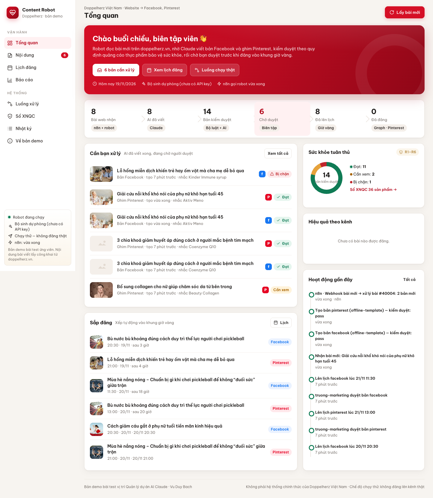
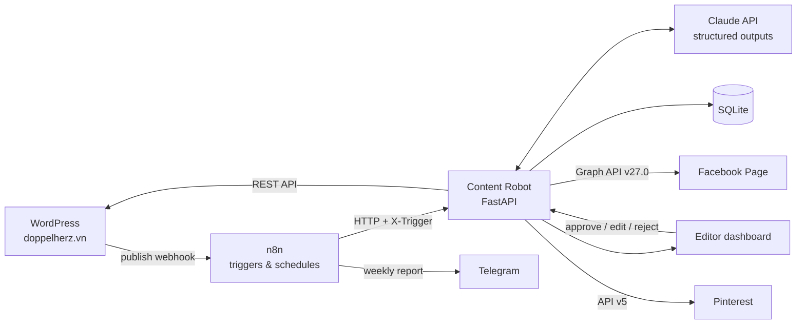
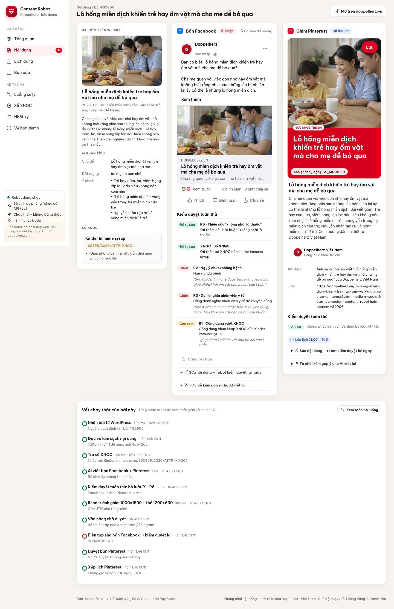
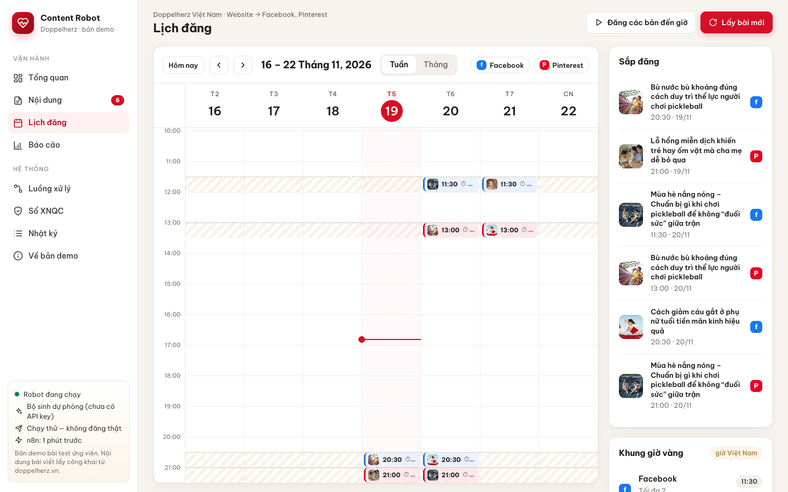
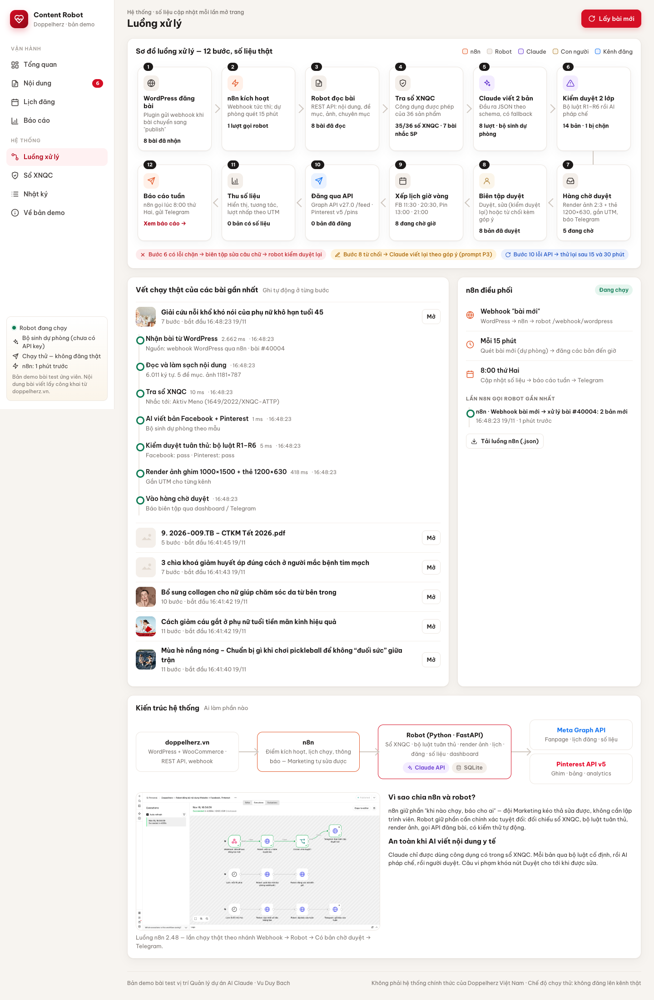
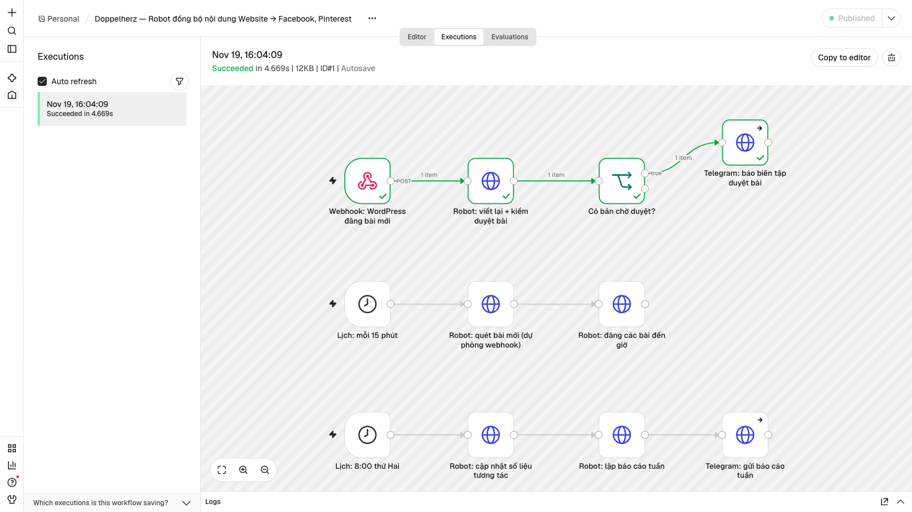

# Doppelherz Content Workflow

> An AI content robot that turns every new article on **doppelherz.vn** into a Facebook post and a Pinterest pin — written by **Claude**, checked against Vietnamese health-supplement advertising rules, approved by a human, scheduled into peak hours and reported weekly.

[](https://github.com/Bachthutruong/doppelherz-workflow/actions/workflows/ci.yml)


[](https://doppelherz-workflow.jiudi.cloud)

**[Live demo](https://doppelherz-workflow.jiudi.cloud)** · **[Assignment report (PDF)](docs/report/Bai_test_QLDA_AI_Claude_Vu_Duy_Bach.pdf)** · **[Tiếng Việt](README.vi.md)**

Built as the take-home assignment for the **AI Project Manager (Claude)** role at Doppelherz Vietnam. It is a working prototype, not an official Doppelherz system: it runs in dry-run mode and never posts to the real Facebook Page.



## Why

| Observation (19 Nov 2026) | Evidence |
| --- | --- |
| Content production stalled | "Kiến thức sức khỏe" articles: 46 in Apr 2026 → **0** from Jul to Nov 2026 |
| Content stays on the website | Facebook 629K followers, Instagram 555, Pinterest **no pins** |
| Images not channel-ready | Featured images from 400×265 to 2560×1709, no 2:3 pins, missing alt text |
| High compliance risk | Every product needs its approved claims (XNQC) and the mandatory "not a medicine" disclaimer |

The robot keeps a steady, multi-channel cadence **without** creating advertising violations.

## Features

- **WordPress ingestion** — REST API polling and a `publish` webhook (mu-plugin in [`integrations/wordpress`](integrations/wordpress)).
- **XNQC claims registry** — built automatically from the WooCommerce Store API: approval number and approved claims for 36 products (35 parsed; non-standard entries are blocked for legal review).
- **Claude writer** — one call returns a typed JSON "social pack" (Facebook post + Pinterest title, description, alt text, overlay, board) via structured outputs, with server-side fallback on refusals. An offline template writer keeps the pipeline running without an API key.
- **Two-layer compliance** — deterministic rules R1–R6 plus an AI legal reviewer; blocking issues lock the Approve button. Disclaimers and XNQC numbers are appended automatically. See [docs/compliance.md](docs/compliance.md).
- **Human in the loop** — approve, edit (re-checked instantly) or reject with feedback for Claude to rewrite.
- **Channel assets** — 1000×1500 Pinterest pins and 1200×630 cards rendered with Be Vietnam Pro; UTM-tagged links.
- **Peak-hour scheduler** — Facebook 11:30 / 20:30, Pinterest 13:00 / 21:00, max 2 posts per day per channel (Asia/Ho_Chi_Minh).
- **Publishers** — Meta Graph API v27.0 (`/{page-id}/feed`) and Pinterest API v5 (`/pins`, with `ai_disclosures`); dry-run mode writes the exact payloads to an outbox.
- **Observability** — per-article execution traces, AI token and cost tracking, audit log, metrics collection and a weekly report with AI insights.
- **n8n orchestration** — webhook, 15-minute schedule and Monday 08:00 report ([`workflows/n8n`](workflows/n8n)).

## Architecture



n8n owns *when things run and who gets notified* (editable by marketing without code); the robot owns everything that must be exact — compliance, rendering, publishing — and is covered by tests. Details: [docs/architecture.md](docs/architecture.md).

## Quick start

Requirements: Python 3.11+ (Docker optional).

```bash
git clone https://github.com/Bachthutruong/doppelherz-workflow.git
cd doppelherz-workflow
make install        # virtualenv + editable install with dev tools
make test           # 20 tests
make demo           # ingest real doppelherz.vn articles (dry-run)
make serve          # dashboard at http://127.0.0.1:8000
```

Enable Claude by setting `ANTHROPIC_API_KEY` in `.env` (copy from [`.env.example`](.env.example)).

### Docker (robot + n8n)

```bash
cp .env.example .env
docker compose up -d --build
# dashboard: http://localhost:8000   ·   n8n: http://localhost:5678
curl -X POST http://localhost:5678/webhook/doppelherz-new-post \
     -H 'Content-Type: application/json' -d '{"post_id": 39906}'
```

The n8n container imports and publishes the workflow on start.

## Configuration

| Variable | Default | Purpose |
| --- | --- | --- |
| `PUBLISH_MODE` | `dry_run` | `dry_run` writes payloads to `data/outbox`; `live` calls the APIs |
| `ANTHROPIC_API_KEY` | — | Enables Claude; without it the offline template writer is used |
| `CLAUDE_MODEL` / `CLAUDE_EFFORT` | `claude-opus-5-5` / `medium` | Model and effort |
| `AI_REVIEW` | `true` | Second-pass AI legal review |
| `FB_PAGE_ID`, `FB_PAGE_TOKEN` | — | Page access token with `pages_manage_posts`, `pages_read_engagement` |
| `PINTEREST_TOKEN`, `PINTEREST_BOARDS` | — | Scopes `pins:write`, `boards:read`; board name → id map |
| `SLOTS_FACEBOOK`, `SLOTS_PINTEREST` | `11:30,20:30` / `13:00,21:00` | Peak-hour slots (local time) |
| `WEBHOOK_SECRET` | — | Shared secret for `/webhook/wordpress` |
| `DATA_DIR` | `./data` | SQLite database, rendered media, outbox |
| `TELEGRAM_BOT_TOKEN`, `TELEGRAM_CHAT_ID` | — | Optional notifications |

## Project structure

```text
doppelherz-workflow/
├── src/content_robot/          # application package
│   ├── wordpress.py            # WordPress REST client and HTML parsing
│   ├── claims.py               # XNQC claims registry (WooCommerce Store API)
│   ├── ai.py                   # Claude writer (structured outputs) + offline fallback
│   ├── compliance.py           # rules R1–R6, disclaimers, UTM
│   ├── images.py               # Pinterest pin / Facebook card rendering
│   ├── scheduler.py            # peak-hour slot allocation
│   ├── publishers.py           # Graph API, Pinterest API, dry-run outbox
│   ├── pipeline.py             # orchestration, traces, retries
│   ├── reporting.py            # weekly report and insights
│   ├── web.py                  # FastAPI dashboard, webhook, JSON API
│   ├── db.py · config.py · __main__.py
│   ├── prompts/                # P0–P4 prompts, used verbatim
│   ├── templates/ · static/    # dashboard UI
│   └── assets/fonts/           # Be Vietnam Pro (SIL OFL 1.1)
├── tests/                      # pytest suite with real doppelherz.vn fixtures
├── workflows/n8n/              # n8n workflow, import directly
├── integrations/wordpress/     # mu-plugin that sends the publish webhook
├── deploy/                     # systemd, nginx, install / deploy / reseed scripts
├── scripts/                    # end-to-end demo scenario
├── docs/                       # architecture, API, compliance, deployment, report, screenshots
├── .github/workflows/ci.yml    # lint, tests (3.11, 3.12), Docker build
└── Dockerfile · docker-compose.yml · Makefile · pyproject.toml
```

## Testing

`make test` runs 20 tests covering HTML parsing, XNQC parsing, every compliance rule (including the "chưa khỏi" vs "chữa khỏi" diacritic trap), the Claude request shape (mocked transport), scheduler limits, both publishers' payloads and HTTP calls, the end-to-end dry-run pipeline and every dashboard page. CI runs lint, tests on Python 3.11 and 3.12, and a Docker build.

## Deployment

The live demo runs on a VPS: `systemd` services for the robot and n8n (private Node 24), nginx reverse proxy and Let's Encrypt TLS. Step-by-step guide: [docs/deployment.md](docs/deployment.md). HTTP endpoints: [docs/api.md](docs/api.md).

## Screenshots

| Review screen | Publishing calendar |
| --- | --- |
|  |  |
| **Workflow & traces** | **n8n orchestration** |
|  |  |

## Limitations

- Dry-run only: no access to Doppelherz's Facebook or Pinterest accounts, so engagement metrics are simulated and labelled as such.
- The XNQC registry is parsed from public product pages and must be verified against the original approval documents before going live.
- Article content belongs to Doppelherz Vietnam and is read from its public website.

## Author

**Vu Duy Bach** — Fullstack & AI Platform Engineer, Hanoi · [linkedin.com/in/bachvd](https://linkedin.com/in/bachvd) · vuduybachvp@gmail.com

Licensed under the [MIT License](LICENSE).
