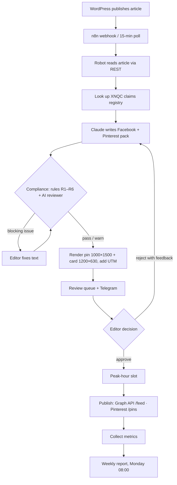
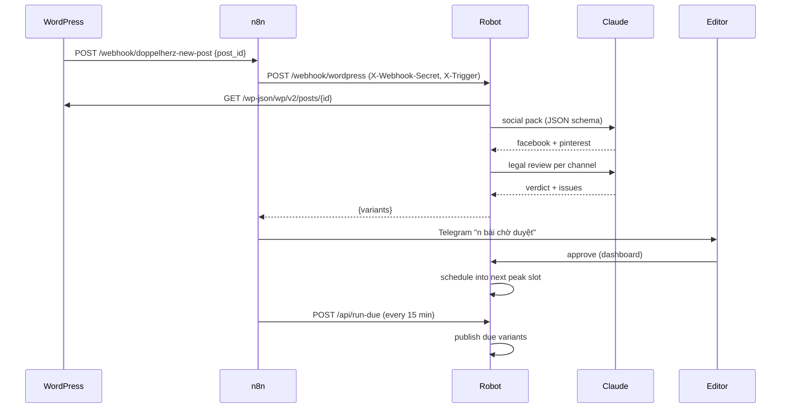

# Architecture

## Components

| Component | Responsibility | Why it is separate |
| --- | --- | --- |
| WordPress (doppelherz.vn) | Source articles, WooCommerce product data, `publish` webhook | Already exposes a REST API — no website changes beyond a mu-plugin |
| n8n | Triggers (webhook, 15-minute schedule, Monday 08:00), notifications | Marketing can change schedules and notifications by drag-and-drop |
| Content Robot (FastAPI) | Claims registry, compliance, rendering, scheduling, publishing, metrics, dashboard | Everything that must be exact lives in tested code |
| Claude API | Write the social pack, legal review, rewrite on feedback, weekly insights | Structured outputs guarantee a typed response |
| Meta Graph API · Pinterest API v5 | Publish, schedule, read metrics | Official APIs only |

## Pipeline

Every step appends to the article's **trace** (`articles.trace`): label, detail, duration and, for Claude calls, token counts and cost. The dashboard's *Luồng xử lý* page renders these traces.

## Sequence: new article

## Data model (SQLite)

| Table | Key columns |
| --- | --- |
| `articles` | `wp_id` (unique), title, url, categories, content, headings, image, products, analysis, status (`processed` / `skipped` / `error`), `trace` |
| `variants` | `article_id` + `channel` (unique), status (`needs_review` / `blocked` / `approved` / `scheduled` / `published` / `rejected` / `failed`), body, title, link, alt text, image, compliance status and issues, AI provider/model, approval, schedule, remote id, attempts |
| `metrics` | variant, impressions, reactions, comments, shares, saves, clicks, `simulated` flag |
| `events` | audit log: time, level, entity (`article`, `variant`, `n8n`, `claims`), message |

## Design decisions

- **Human approval is mandatory.** The company carries legal responsibility for health-supplement ads, so AI never publishes on its own; blocking findings lock the Approve button.
- **Deterministic rules before AI.** Rules are fast, explainable and testable; the AI reviewer catches semantic issues the rules cannot.
- **Graceful degradation.** If Claude fails or is unavailable the offline writer produces a draft, so the queue never stalls.
- **Dry-run first.** Publishers build the exact API payloads; switching to `live` only requires tokens.
- **Single SQLite file.** Enough for thousands of articles per year; PostgreSQL is the planned production store.
